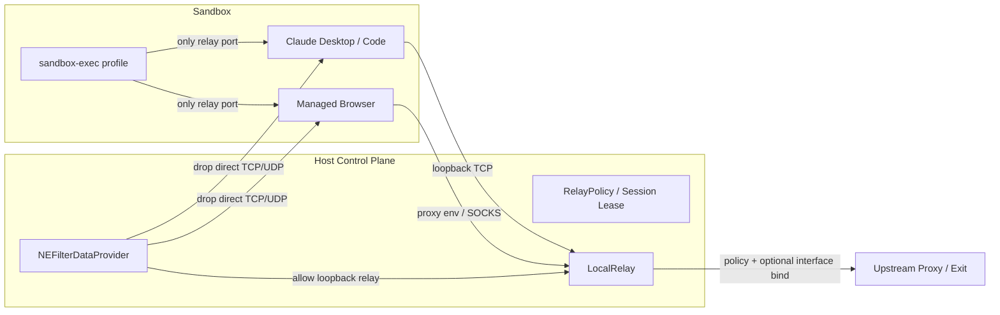

# Design

## Architecture



## Layers

1. **SBPL layer**: 保留 `deny network*`，仅放行 `127.0.0.1:<relay>` 与必要本机 IPC。该层阻止沙箱内子进程绕过浏览器/CLI 代理设置。
2. **NE filter layer**: 扩展现有按 audit token 匹配的 `FilterScope`，把保护对象从 Claude 扩展到受控浏览器及其 helper。provider 收到新 flow 时：
   - loopback relay endpoint → allow；
   - 科学控制 socket 等显式本机 IPC → 可配置 allow；
   - 其他 TCP/UDP/DNS → drop。
3. **Relay policy layer**: 新增纯函数 `RelayPolicy`，输入 `RelayTarget`，输出 `allow / deny(local|policy) / rewrite`。规则由会话 lease 保存，支持域名、IP、CIDR、端口和默认拒绝。
4. **Exit layer**: relay 连接上游时可选绑定接口 index / 本机地址；绑定失败必须 fail-closed。上游继续支持 HTTP CONNECT 与 SOCKS5。
5. **Verification layer**: 复用有界 tcpdump 包头验证与 STUN/DNS 探测，新增“保护 PID + 非 relay 目的 IP = 0 包”的判定；无法归属仍是 unknown。

## Browser model

1. 浏览器放在独立 `sandbox-exec` 会话，使用独立 HOME、profile 和 relay 端口。
2. 启动参数显式设置 SOCKS5 代理、禁用 QUIC、禁用或限制 WebRTC 非代理候选。
3. `FilterScope` 按 browser bundle path、bundle ID、signing identifier 和同一 UID 识别主进程与 helper。
4. 浏览器读到的宿主 IP/接口元数据仍然存在；防护目标是让它无法直接使用这些地址通信，也不是让 API 返回假数据。

## Failure Model

1. NE absent / denied：只提供诊断，不启用“强制隔离”标签。
2. Relay stopped：NE 仍阻断直连；relay endpoint 不可达导致应用断网。
3. Upstream failure：relay 拒绝新连接；已建立隧道随 socket 关闭。
4. Provider restart：系统重新调用 `startFilter`；vendor configuration 必须能独立恢复策略。
5. Network change：session lease 作废，relay pause 保留端口，验证出口后手动或按现有规则恢复。

## Data Model

```swift
struct RelayRule: Codable, Equatable, Sendable {
    var hostPatterns: [String]      // exact domain, suffix domain, IP, CIDR
    var ports: ClosedRange<Int>?
    var action: RelayAction         // allow or deny
}

struct NetworkLease: Codable, Equatable, Sendable {
    var id: UUID
    var createdAt: Date
    var relayPort: Int
    var relayGeneration: UInt64
    var policyFingerprint: String
    var exitAnchor: String?
    var boundInterface: String?
}
```

`NetworkLease` 不保存代理密码与原始订阅；凭证只保留不可逆 marker。

## Signing And Release

1. Development profile：`content-filter-provider`，用于授权开发机。
2. Distribution：Developer ID + `content-filter-provider-systemextension`，App 与 extension 同 Team ID。
3. 当前仓库的门禁逻辑保留：缺签名/profile/entitlement 时禁用入口，并明确“未生效”。
4. 实机验收前不得把 NE 状态显示为 active。

## Testing

1. `RelayPolicy` 纯测试：IPv4/IPv6/CIDR/domain suffix、端口、默认拒绝、畸形输入。
2. `FilterScope` 扩展测试：Claude、Node CLI、browser helper、其他 UID、未识别进程。
3. relay 集成测试：HTTP/SOCKS 允许、策略拒绝、本地网段拒绝、上游认证失败、pause 后新连接失败。
4. provider 单元测试：scope 解码失败、非 TCP、无 endpoint、非保护进程、loopback relay。
5. 实机矩阵：IPv4/IPv6、TCP/UDP/DoH、代理断开、Wi-Fi 切换、休眠唤醒、provider 重启、受控浏览器 WebRTC。
